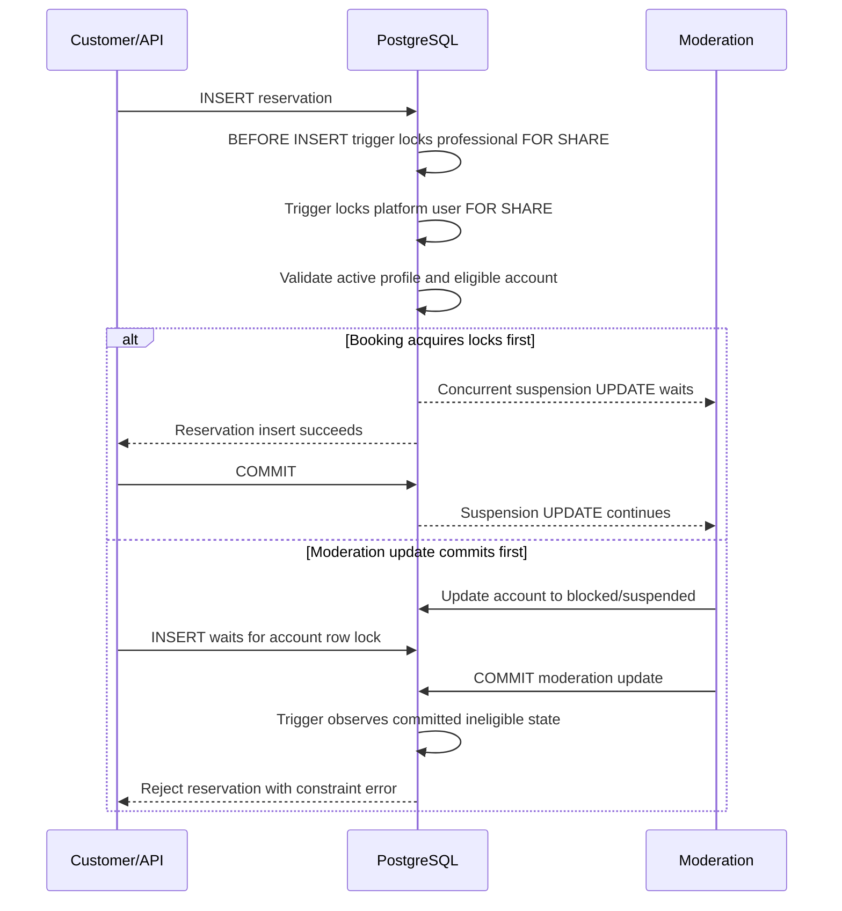

# Professional booking eligibility transaction

Date: 2026-10-22  
Status: proposal; not an executable migration and not applied to Supabase.

## Decision under review

The application checks professional profile and owner account eligibility before it writes a reservation. That check and the later INSERT are separate requests, so a moderation update can commit between them. The proposed database trigger is a transaction-level guard on reservation INSERT or professional reassignment.

The trigger uses `SECURITY DEFINER` with `search_path = pg_catalog, public` because customer reservation inserts are allowed while RLS can hide restricted professional/account rows from the caller. It locks the professional row and then its platform user row with `FOR SHARE`, checks that the profile is active and the account is active or has an expired suspension, then lets the reservation write continue. `clock_timestamp()` is evaluated after any lock wait.

## Sequence

The transaction order defines the boundary: a reservation whose trigger obtains both locks first is accepted before the later moderation change; a moderation update that commits first blocks the reservation. This proposal does not cancel an already-created pending Stripe checkout if moderation occurs after its reservation row commits.

## Evidence

- CI PostgreSQL contract harness creates a disposable local database and loads this proposal outside `supabase/migrations/`.
- Both lock orderings passed locally on PostgreSQL 17, alongside active, inactive, blocked, current suspension, and expired suspension cases.
- The authenticated role test passes without direct SELECT grants on the sensitive tables.
- Full local suite: 75/75 tests; typecheck passes; lint 0 errors and 350 warnings.
- CI run 39707978757 on commit `b3b5b32730c190906103ed230711e63de018eb77` passed audit, lint, typecheck, unit tests, synthetic PostgreSQL discovery/booking contract, and build. The migration repository gate still fails on four provenance/reconciliation blockers.
- Follow-up CI run 39708334447 on docs-only commit `167306189a23321fd40c9261bed31f112ad69fdd` passed audit, lint, typecheck, automated tests, PostgreSQL contract, and build; the migration repository gate still fails on the same four blockers and reports 45 legacy filename warnings.

## Limitations and required validation

- The fixture is synthetic and does not reproduce the complete Supabase schema, deployed RLS policies, extensions, trigger ordering, or production grants.
- The SQL remains a proposal, not an applied migration. Do not register it as applied or move it into the executable migration directory until migration provenance policy and isolated Supabase review permit it.
- Verify the SECURITY DEFINER function owner privileges, actual owner moderation transaction order, RLS, and trigger interaction on an isolated Supabase project.
- Decide how to handle pending Stripe sessions created before a later suspension, and test checkout/webhook compensation.
- Keep release NO-GO until isolated Supabase integration, authenticated E2E, and migration gate evidence pass.
